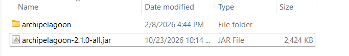

# The Legend of Dragoon (Severed Chains) Setup Guide

## Required Software

- A legally purchased copy of *The Legend of Dragoon.*
    - *all 4 discs needed*
    - *only NA non-modified ISOs usable*
- [Severed Chains](https://legendofdragoon.org/projects/severed-chains/)
    - *requires latest dev build of 3.0.0 at this time.*
    - *other mods not supported at this time, use at your own risk*

## Installation via Severed Chains

**You must set up Severed Chains before you can install mods for it.**

- Follow the installation process for Severed Chains.
  See [here](https://legendofdragoon.org/guides/setup-severed-chains/).
- Download the latest release of [Archipelagoon](https://github.com/pkolb-dev/Archipelagoon/releases/latest)
- Extract the .zip into Severed Chains' mods folder
    - you should see an `archipelagoon` folder AND a .jar file.
      

## Updates and New Releases via Severed Chains

For up-to-date news and release info for Severed Chains, please join the [discord](https://discord.gg/legendofdragoon)

## Starting a Game

### New Game

To enable archipelago, please create a new campaign with the Archipelagoon mod enabled

### Returning / Async Game

Simply load your save that you used prior and enter your connection info! Done!
If your port changed, you can update that in the options menu.

## Severed Chains Options

Please select the "Archipelago" preset to set the various settings properly

## Troubleshooting

If you have any issues with setup, please ask in the Legend of Dragoon thread of `#custom-games`

### Common Issues:

1) My game is crashing when I open a shop
    - Please ensure that your mod is installed correctly. This is typically caused by an improper file structure.
        - In your Severed Chains `mods` folder you should have an `archipelagoon` folder AND an archipelagoon .jar file.
2) I don't have any characters
    - Please verify you are actually connected to the archipelago server and slot.
